# Unturned+

**A desktop companion for Unturned players** — track servers live, plan your bases, organize your inventory and coordinate with your team. Built with Electron for Windows.

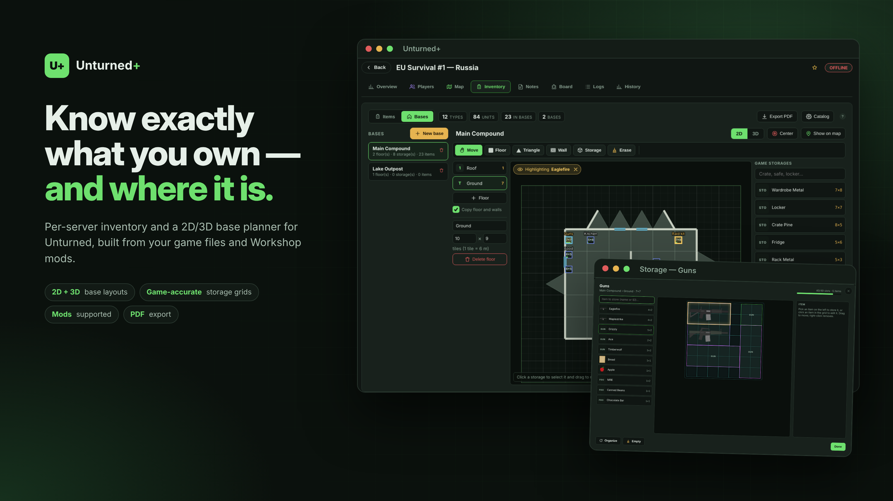

> 🇧🇷 Leia em português: [docs/README.pt-BR.md](docs/README.pt-BR.md)

## Features

- **Live server tracking** straight from the game's Query Port (A2S / Source Engine Query) — name, map, players, Workshop mods and public config. No API key, no token.
- **Player tracking, logs & activity** — joins/leaves, uptime and history per server.
- **Interactive maps** imported from your own Unturned install (official + Workshop), with locations, airdrops and custom markers.
- **Inventory per server** — item catalog read from the game and mod files (icons, IDs, map-exclusive items), quantities and an English PDF export with spawn commands.
- **Base planner** — multiple bases and floors, square and triangle pieces, walls with doors/windows/garage/custom multi-span doors, wood/metal/brick materials, stacked storages with the in-game grid, and a 3D view.
- **Placeables with real action areas** — claim flag, generators, sentries, workbenches, beds, lights… radii taken from the official game data.
- **Raid calculator, board, notes, schedule and teams.**
- **In-game overlay** (borderless window) with global hotkeys.

## Screenshots

| | |
|---|---|
| 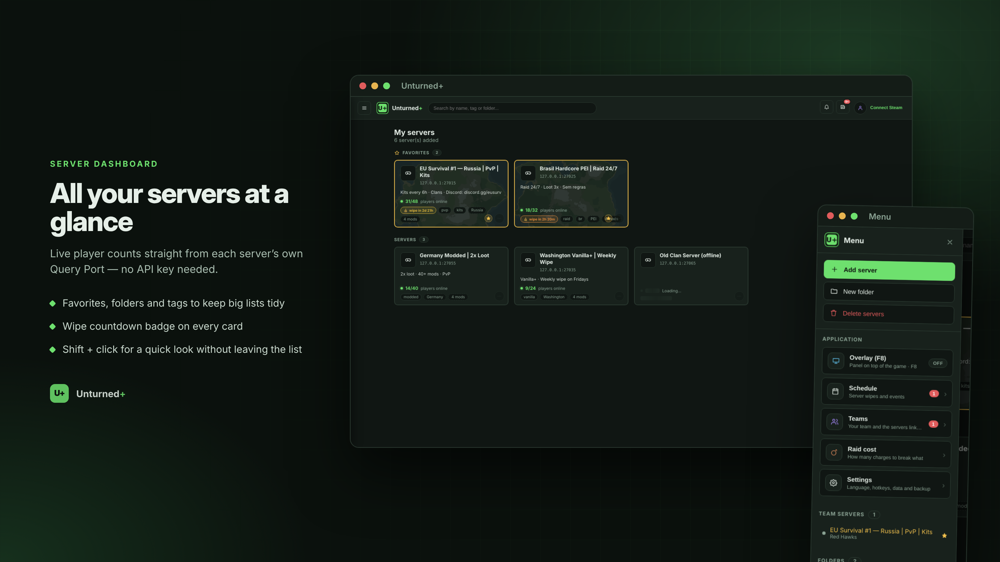 **Servers** | 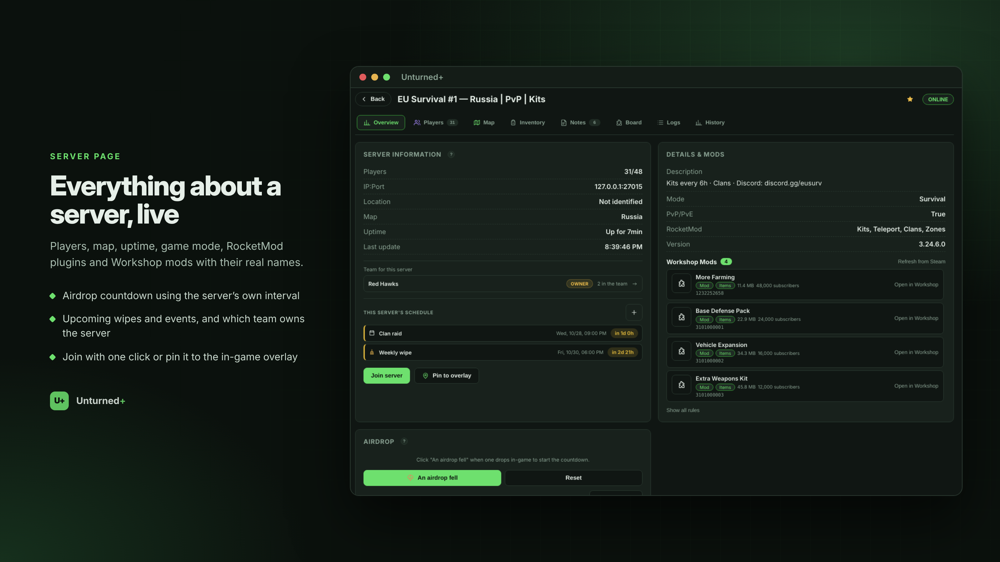 **Server page** |
| 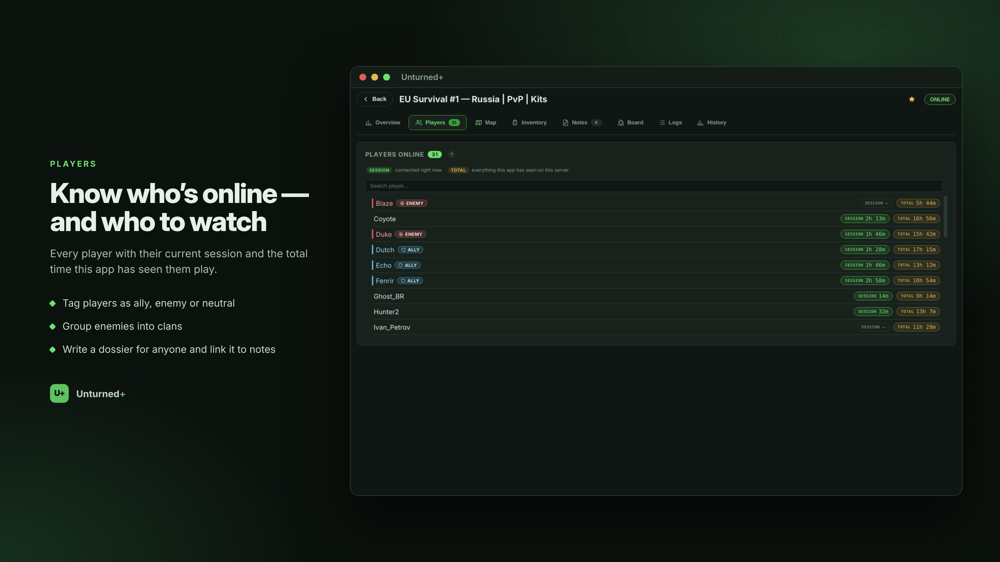 **Players** | 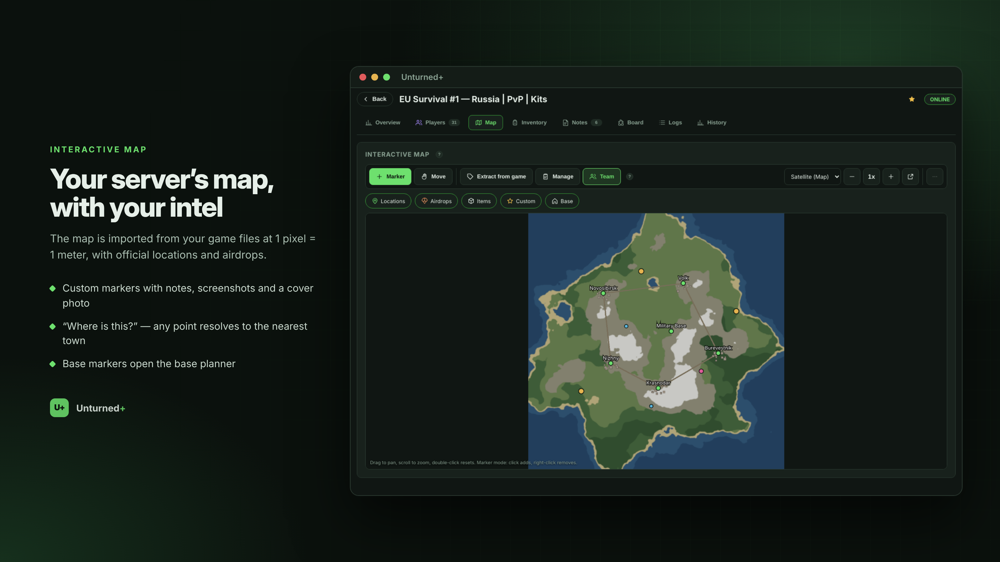 **Map** |
| 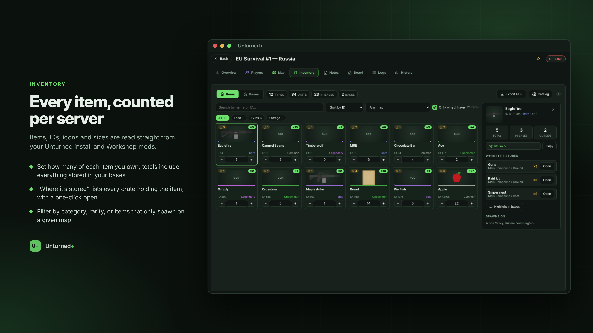 **Inventory** | 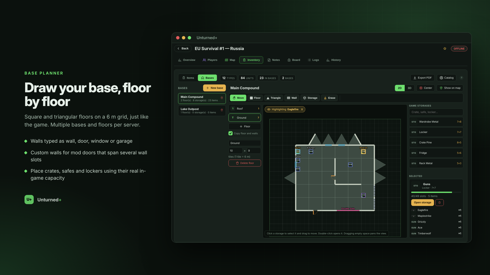 **Base editor** |
| 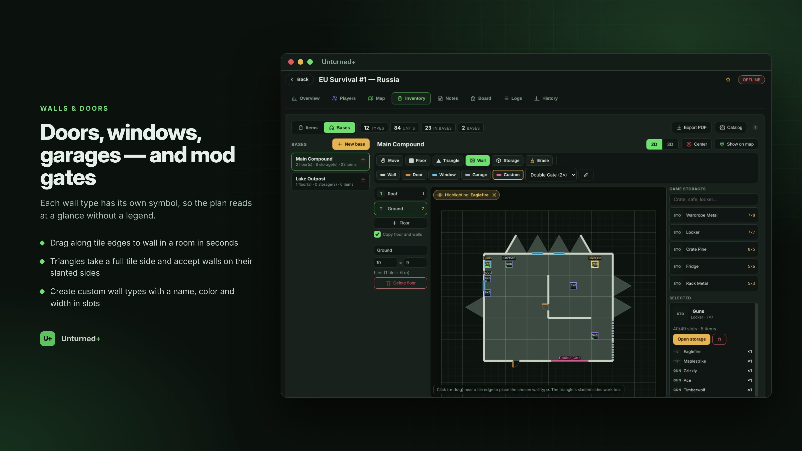 **Walls & doors** | 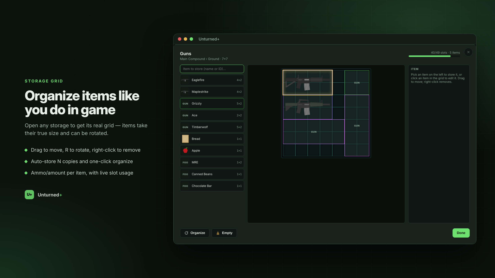 **Storage grid** |
| 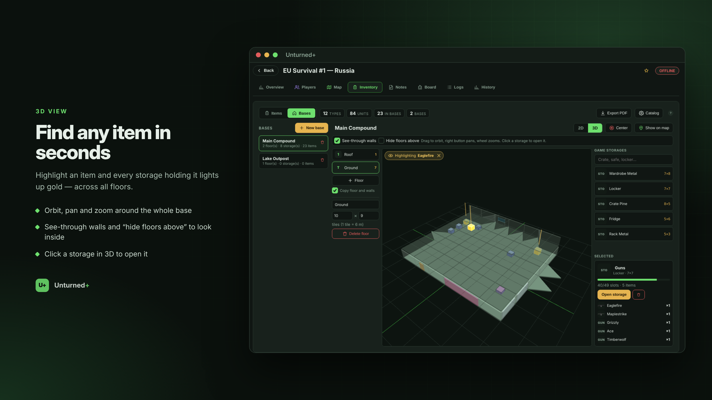 **3D view** | 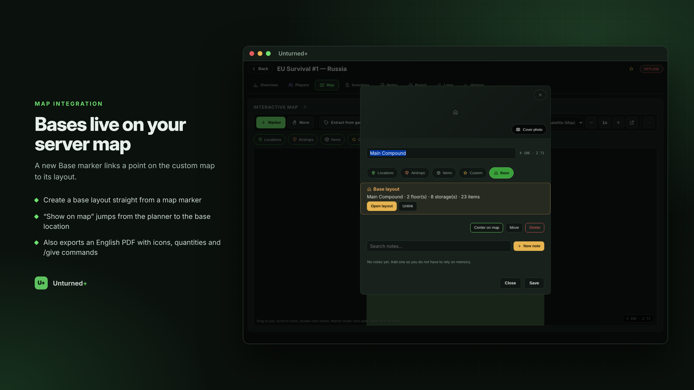 **Base on the map** |
| 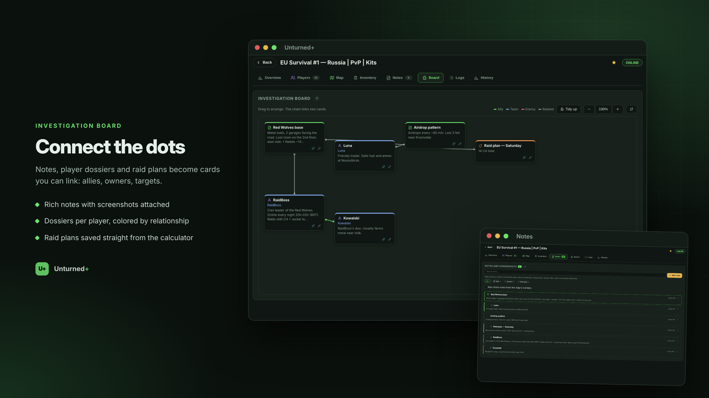 **Board** | 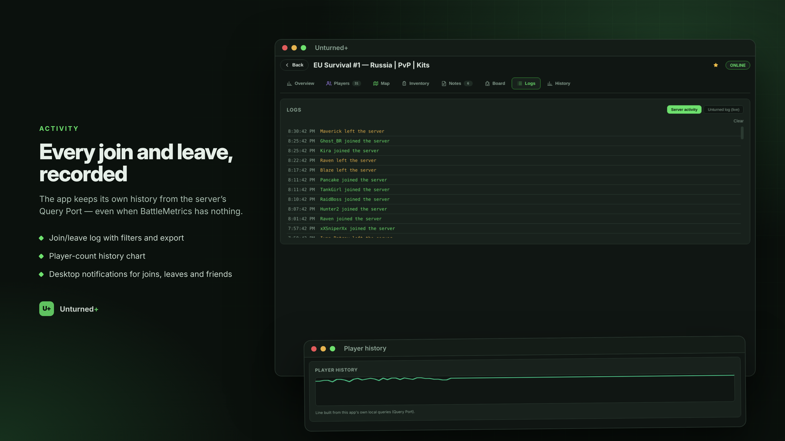 **Activity** |
| 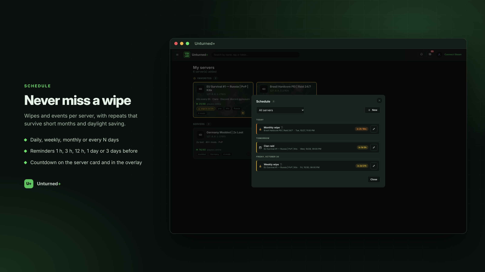 **Schedule** | 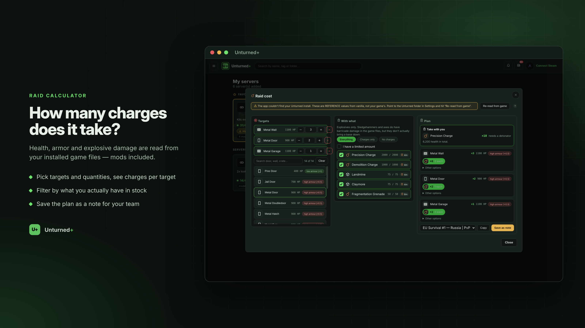 **Raid calculator** |
| 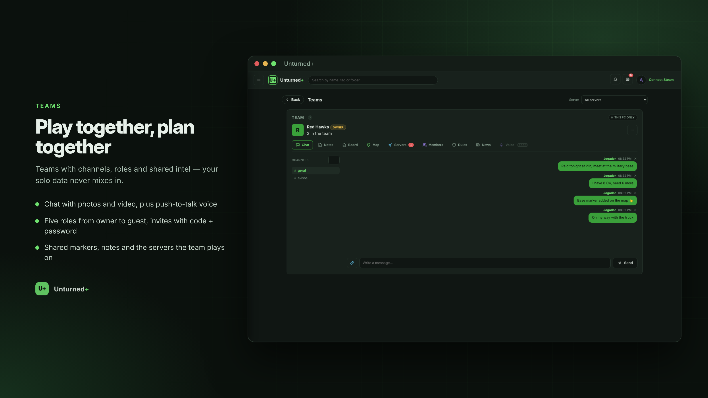 **Teams** | 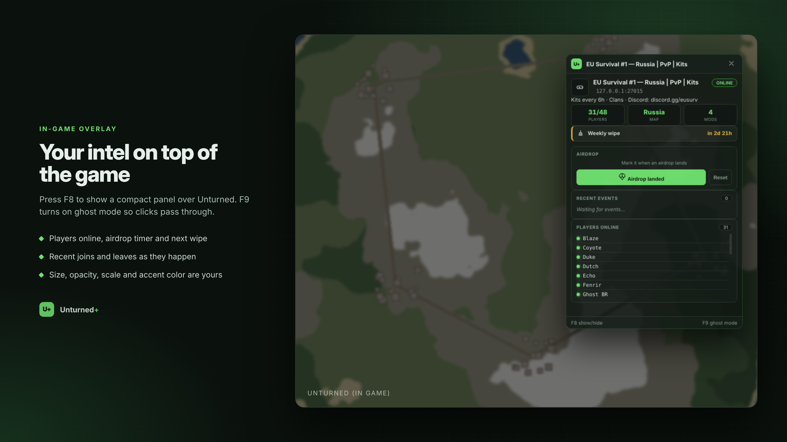 **Overlay** |

## Getting started

```bash
npm install
npm start
```

Requires Node.js 18+. Built and tested on Windows 10/11 (runs on Linux/macOS for development).

### Build for Windows

```bash
npm run dist            # portable .exe + installer in dist/
npm run dist:portable   # portable only
npm run dist:installer  # installer only
```

The executables are not code-signed, so Windows SmartScreen will warn on first run (**More info → Run anyway**).

## Game assets

Unturned+ does **not** ship any game assets. Maps, icons and item data are read from **your own** Unturned installation and Workshop folder. Placeable values (claim radius, generator wire range, etc.) come from the public [Unturned-Datamining](https://github.com/Unturned-Datamining/Unturned-Datamining) data.

Unturned is a trademark of Smartly Dressed Games. This is an unofficial fan project.

## Tech

Electron 28 · vanilla JS · Canvas 2D · Three.js · A2S/gamedig · i18n (pt-BR / en-US)

## License

MIT — see [LICENSE](LICENSE).
